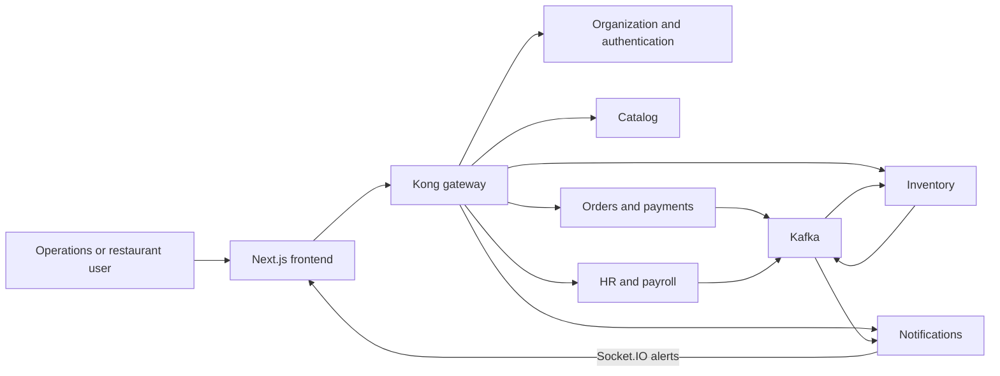

# FoodMatrix

FoodMatrix connects restaurant ordering, kitchen preparation, billing, inventory, and workforce management. An Operations dashboard manages the wider business; a Restaurant dashboard supports each location.

**Read the [detailed project guide](PROJECT_GUIDE.md)** for architecture, database ownership, authentication, workflow diagrams, API routes, setup, testing and troubleshooting. For cloud deployment, see the [AWS deployment runbook](deploy/README.md).

## What the application provides

| Restaurant workspace                                          | Operations workspace                                        |
| ------------------------------------------------------------- | ----------------------------------------------------------- |
| Dashboard, waiter pad, cashier POS, kitchen display           | Business overview and restaurant management                 |
| Restaurant menu pricing and availability                      | Shared menu, modifiers, ingredients and recipes             |
| Local stock, requests, deliveries and movements               | Warehouse inventory, approvals, fulfillment and stock audit |
| Attendance, staff, shifts, leave, wages, payroll and payslips | Staff directory and system login management                 |
| Restaurant alerts and settings                                | Warehouse notifications and settings                        |



Each backend owns a separate PostgreSQL database. HTTP supports immediate access/pricing checks; Kafka supports asynchronous events. **Kitchen item readiness triggers ingredient consumption. Completing the order separately requires readiness and payment.**

## Technology

- Frontend: Next.js 16, React 19, TypeScript, Tailwind CSS 4, Zustand, Recharts, Lucide and Socket.IO client.
- Backend: six NestJS 11 services, Prisma 7, PostgreSQL, Better Auth, KafkaJS, Socket.IO and PDFKit.
- Infrastructure: Kong, Kafka, Docker, Terraform, Kubernetes/Helm, AWS EKS/ECR/RDS and optional MSK.
- Observability: OpenTelemetry, Prometheus, Loki, Tempo and Grafana.
- Verification: ESLint, TypeScript, Jest, Supertest, disposable-database integration tests and deployment validation scripts.

## Local development

Use Node.js 22, npm, PostgreSQL and Docker Desktop with Linux containers. Each application has its own package manifest; there is no root npm workspace command.

1. Follow [local setup](PROJECT_GUIDE.md#12-local-development-setup) to create six databases, configure environment files, install dependencies, generate Prisma clients and apply migrations.
2. Start infrastructure from the repository root:

   ```powershell
   docker compose -f backend/kafka/docker-compose.yml up -d
   docker compose -f backend/kong/docker-compose.yml up -d
   ```

3. Start each backend in its own terminal using `npm run start:dev` from its directory. Start Organization first, followed by Catalog and the remaining services.
4. For a new installation only, run Organization's `npm run db:bootstrap` with the documented private bootstrap variables. Create restaurants and scoped system logins through Operations.
5. Run `npm run dev` from `frontend`, then open [the login page](http://localhost:3000/login).

| Process              | Local port       |
| -------------------- | ---------------- |
| Frontend             | 3000             |
| Organization         | 3001             |
| HR                   | 3002             |
| Catalog              | 3004             |
| Orders               | 3005             |
| Inventory            | 3006             |
| Notifications        | 3007             |
| Kong proxy / admin   | 8000 / 8001      |
| Kafka host listeners | 9094, 9095, 9096 |

The root `docker-compose.yml` provides an alternative container development stack: all six services, frontend, Kong, an NGINX edge and the included Kafka cluster. It requires Docker Compose 2.20+, existing PostgreSQL databases, and a configured `.env.docker` in each service. See [local container setup](deploy/README.md#6-local-container-development) before starting it; use a different port or stop native frontend development if port 3000 is already occupied.

## Verification and deployment

From a backend directory, use `npm test -- --runInBand` and `npm run build`. Integration tests require service-specific test database variables; see [testing instructions](PROJECT_GUIDE.md#13-testing-and-verification). Several backend lint scripts include `--fix`.

From `frontend`, use `npm run lint`, `npx tsc --noEmit` and `npm run build`.

[deploy/README.md](deploy/README.md) covers infrastructure, secrets, migrations, monitoring, rollout and rollback. The Jenkins pipeline runs lint, types, Jest coverage and HTTP tests, validates deployment configuration, and enforces the main-branch Sonar quality gate before image builds. Optional publishing and approved staging deployment use the shared scripts. Configure the agent, Sonar webhook, AWS identity and credentials as described in [jenkins/README.md](jenkins/README.md). These assets do not by themselves establish that a production environment has passed acceptance testing.

## Documentation

| Reference                                                                | Contents                                                                           |
| ------------------------------------------------------------------------ | ---------------------------------------------------------------------------------- |
| [PROJECT_GUIDE.md](PROJECT_GUIDE.md)                                     | Detailed functional and technical reference, diagrams, setup, API index and limits |
| [deploy/README.md](deploy/README.md)                                     | AWS provisioning and deployment runbook                                            |
| [Organization schema](backend/organization-service/prisma/schema.prisma) | Accounts, franchises, restaurants and roles                                        |
| [Catalog schema](backend/catalog-service/prisma/schema.prisma)           | Menu, overrides, modifiers and recipes                                             |
| [Order schema](backend/order-service/prisma/schema.prisma)               | Orders, items, payments and consumption events                                     |
| [Inventory schema](backend/inventory-service/prisma/schema.prisma)       | Stock, transfers, movements and retry records                                      |
| [HR schema](backend/hr-service/prisma/schema.prisma)                     | Staff, attendance, scheduling, leave and payroll                                   |
| [Notification schema](backend/notification-service/prisma/schema.prisma) | Notifications and durable socket delivery                                          |

Keep real credentials, authentication secrets, bootstrap passwords and internal API keys out of version control. Configuration examples are placeholders.

## Cloud deployment and DevOps

FoodMatrix runs on **AWS EKS (`foodmatrix-staging`, `ap-south-1`, EKS Auto Mode)** with **Amazon RDS PostgreSQL**, **Amazon ECR**, in-cluster **Kafka**, **Kong**, and a **Cloudflare Tunnel** (`cloudflared`) for public HTTPS ingress.

### Automatic CI/CD (GitHub Actions)

[`.github/workflows/deploy-eks.yml`](.github/workflows/deploy-eks.yml) deploys automatically on every push to `main`:

1. Authenticates to AWS via **IAM OIDC** (no static AWS keys stored in GitHub).
2. Diffs changed paths against the currently deployed commit tag so only modified services run `test-and-build` in parallel; unchanged services are fast-retagged server-side in ECR (`retag-unchanged`).
3. Runs `helm upgrade --atomic` into the `foodmatrix` namespace and verifies the live deployment with [`deploy/scripts/smoke-test.sh`](deploy/scripts/smoke-test.sh).

### Manual CI/CD and SonarQube (Local Docker Desktop)

- **Jenkins (`jenkins/docker-compose.yml`):** Configured for manual `Build with Parameters` runs on `matrix-ci` (no GitHub webhooks or polling). Enable `RUN_SONAR` to run `sonar-scanner` against local SonarQube and enforce the Quality Gate (`-Dsonar.qualitygate.wait=true`) before building and deploying.
- **SonarQube (`sonarqube/docker-compose.yml`):** Runs locally with PostgreSQL 17 and [`sonar-project.properties`](sonar-project.properties) (`sonar.projectKey=foodmatrix`), scanning `frontend` and all six backend services. Requires a local gitignored `sonarqube/.env` (`SONAR_DB_PASSWORD`).

### Observability stack (EKS `monitoring` namespace)

Installed via [`deploy/scripts/install-observability.sh`](deploy/scripts/install-observability.sh) with `observability.enabled=true` and `observability.kongServiceMonitor=true` on the `foodmatrix` Helm release:

| Tool | What it does |
| --- | --- |
| Prometheus | Metrics collector. Scrapes every pod, EC2 node, and Kong every few seconds to record CPU, RAM, restarts, and HTTP traffic numbers. |
| Alertmanager | Alarm system. Watches Prometheus rules (from `deploy/observability/alerts.yaml`) and fires alerts if a deployment goes down or pods keep crashing. |
| Loki | Log storage. Stores all `console.log` / error logs from your backend services and frontend in one searchable place. |
| OTel Logs (`otel-logs-agent`) | Log shipper. Runs on every EC2 node, reads container log files, and sends them to Loki. |
| Tempo | Trace storage. Stores request journeys (e.g., Frontend → Kong → Order Service → Postgres) so you can see where a slow request spent time. |
| OTel Operator + Gateway | Auto-tracker. Automatically attaches OpenTelemetry to your Node.js pods (sampling `10%` of requests) and forwards metrics/traces to Prometheus and Tempo. |
| Grafana | Dashboard UI. Connects to Prometheus, Loki, Tempo, Alertmanager, and AWS CloudWatch (RDS metrics) in one browser UI (`kubectl port-forward -n monitoring svc/grafana 3000:80`). |

### AWS cost control (pause and resume)

| Script | Purpose |
| --- | --- |
| [`deploy/scripts/pause.sh`](deploy/scripts/pause.sh) | Scales all deployments and statefulsets in `foodmatrix` and `monitoring` to `0` (so EKS Auto Mode terminates EC2 nodes) and optionally stops the RDS instance. |
| [`deploy/scripts/resume.sh`](deploy/scripts/resume.sh) | Optionally starts RDS (waiting if it is still stopping), scales `foodmatrix` and `monitoring` back to `1` so EKS Auto Mode provisions nodes, waits for readiness, and prints the active `trycloudflare.com` URL. |